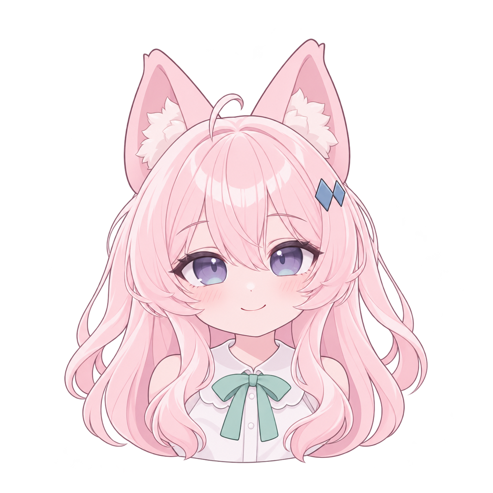

# 桌边伙伴

把自己的 3D 角色放到 Windows 桌面上。她会散步，停下来转身看你。你可以用鼠标碰她、从轮盘换装，也可以和她说几句话。聊天时，AI 可以从当前模型支持的动作里挑一个，边回答边做出来。

**第一次使用**可以从 [GitHub Releases 下载 Windows 运行包](https://github.com/shiyo1843-tech/Deskside-Companion/releases/latest)，解压整个 ZIP，双击 **Windows → 桌边伙伴.exe**。支持 Windows 10/11 x64，包内自带 Unity 播放器与 .NET 桌面运行组件。

第一次打开会看到示例角色「云团」。右键轻点角色或按 **Ctrl + Alt + P** 打开轮盘，在「角色 → 导入模型」里选自己的 VRM 或 GLB。想聊天时，点 **接入自己的 AI**，填写接口地址、模型名和 API Key。日常展示和鼠标互动可离线使用。

## 操作

- **在角色身上按住右键约四分之一秒，再拖动鼠标**，就会把她拎起来。人形角色双脚离地，左右腿交替收起。拖快一点，身体和可动的头发会跟着晃，松手后角色落回原来的姿势。模型自带可识别的悬挂动画时优先使用它。**右键轻点**或 **Ctrl + Alt + P** 打开轮盘。点击轮盘中间退回上一级，首页点中间收起。角色周围的透明区域可点到下面的窗口。
- **左键触碰角色**。碰眼睛会闭眼，松开后睁开。鼠标经过能碰的发束、耳朵、尾巴或衣摆时会把它们拨开。左键按住约 0.22 秒，再移动鼠标，才会抓住允许抓取的部件；松手会回弹。右键按住约 0.22 秒再移动可以搬动整个窗口。
- 在原角色定义了手或手指接触反应的地方，鼠标会驱动原 Animator 参数。缺少原触碰动作的人形模型会用局部回应：碰脸颊稍微侧头，点手腕会缩手，碰小腿或鞋会轻动相应的一侧。具体能抓哪里取决于角色骨骼和交互设置。普通静态模型仍可轻点回应。
- 轮盘顶端的 **角色菜单** 保留 VRChat 角色自带的图标、名称、子菜单与参数。比如 Lime 的 **角色菜单 → 衣柜** 可以选白裙或格纹套装。**动作、表情、衣装** 提供常用入口。动作可持续播放，表情可点回自然状态，衣装勾选可重复切换。没有原菜单的模型会根据实际骨骼、表情、动画片段与网格显示可用项目。
- **按住鼠标中键左右拖**可连续旋转 360°。也可以在控制台左侧角色预览上按住左键左右拖。角色窗口获得焦点后，按 **← / →** 每次微调 1°，按住可连续调整。显示页也有左右微调和回正按钮。滚动滚轮可改变桌面大小。
- **角色 → 导入模型**可以添加本地文件。点击列表切换，按“收起”后桌宠继续待在桌面上。
- **轮盘 → 动作 → 待机姿势**可以选自动变换、站着、蹲下或趴着看四周。自动模式下，人形角色会走一小段，收步回正后休息。她蹲下会面向屏幕，趴着时会慢慢转头。有合适姿势时优先使用模型自带的动画。常规散步和收步取自 Unity Timeline 的 Gameplay Sequence Demo，蹲趴过渡及环顾取自 Quaternius 的 Universal Animation Library。
- 散步结束后，人形角色会原地换脚转向屏幕。左右转身取自 Quaternius 的 Turn90_L 和 Turn90_R。转身过程中也可以中键拖动或按方向键，手动控制朝向。
- **显示 → 渲染分辨率**有 720×880、1080×1320、1440×1760、2160×2640 四档。默认勾选“按桌面大小优化渲染”，以所选档位为上限，按实际显示大小超采样后传图。关闭后始终按所选档位绘制。显示页分别列出 Unity 输出和桌面窗口提交的实时帧数。
- **轮盘 → 表情 → 跟随动作**使用当前模型能识别的表情。选择具体表情可以固定，切回“跟随动作”恢复自动。手势、蹲下和趴着看四周会在相应时刻切换表情和强度。每个角色分别保存选择。
- **显示 → 自主动作间隔**默认“安静”。每次自主动作完成后休息 45–80 秒，可改为 22–40 秒或 10–20 秒。关掉“允许角色在桌面上走动”后仍能在原地换姿势。要固定姿势，去轮盘选择站着、蹲下或趴着。
- 公开运行包附带原创示例「云团」和「栗栗」。「示例模型」文件夹里可以找到这两个 GLB，也可以导入自己持有的其他模型。

亮度在 **显示 → 当前角色的灯光亮度** 调整。每个角色单独保存。100% 使用对应材质的默认灯光，MToon 模型使用较弱的补光，保留浅发和皮肤细节。

没有人形骨架的模型也会自主移动，到达目的地后回到导入时的正面。桌宠能识别行走片段时播放原动画，其他模型用小跳步移动。**动作 → 待机方式**可选自动活动或原地待机。**轻轻弹一下**可以从轮盘或聊天触发。只有一个整体网格时，菜单会省去单件衣物开关。

## 聊天

打开「显示 → 让 AI 随聊天做动作和表情」，可以对当前角色说“朝我挥挥手”或“比个耶，再笑一下”。桌宠把当前模型能做的动作和表情列给 AI。云端阿璃、哈基米以及兼容接口都可以随回复选一个动作和一个表情，也可以只说话。手动固定的表情或循环动作会优先保留。新导入的模型按自己的菜单参与，没有人形骨架的模型也能用轻微弹跳回应。自定义模型需要能按请求返回选择，纯文字回复仍可阅读。

**接入自己的 AI**

| 桌宠设置 | 填写方法 |
|---|---|
| 接口地址 | 填服务商提供的 Chat Completions 完整地址，也可填以 `/v1` 结尾的基础地址。已启动的本机服务可使用 HTTP，例如 `http://127.0.0.1:1234/v1`。 |
| 模型名 | 填该接口提供的模型 ID。连接本机推理服务时，填已加载的模型名。 |
| API Key | 填自己的 Key，免密服务可留空。密钥由当前 Windows 用户加密保存在本机，也可在「更多密钥设置」指定环境变量名。 |

点 **保存并开始聊天** 即可向当前角色发送中文消息。桌宠直接连接所填的服务，模型费用和额度依服务商而定。每个角色、接口和模型的本地对话分别保存。更换接口时，需要为新地址提供它自己的密钥。

回复到达时，角色旁会出现带头像、名字和说话身份的紫色对白框。头像取自桌面角色的实时画面，会跟着转头、表情和换装更新。人形模型按眼睛或头部取景，静态模型显示全貌。长回复自动翻页，收起面板也能看，完整文字保存在聊天页。在“显示”页可以分别开关走动和气泡。

在 **聊天** 页输入文字，按发送或 Ctrl+Enter。已有璃伴配对的用户还可以在 **服务** 页为角色选择自己配对的云端人格。绑定同一位云端人格的两个外观共享她的云端记忆，QQ 同步依原来的璃伴设置。公共 API 聊天单独连接使用者填写的服务。

本机可以复用当前 Windows 用户的璃伴配对。也可在服务页导入新签发的 .alilink 文件。桌宠用本机璃伴的 build-config.json 核对服务器和证书，另行指定文件可设置 DESKPET_CLOUD_CONFIG。设备凭据由 Windows DPAPI 加密。迁移到另一台电脑时须在那台电脑配对。

自定义服务支持 **Chat Completions** 格式。请求发往远程服务器时使用 HTTPS，只带当前角色在该接口和模型下的最近对话。请求失败时应用会显示原因。

角色库、缓存模型、聊天、位置和设置保存在 **%LOCALAPPDATA%\DeskPet**。模型导入后可以移动原文件。云端配对和私人记录仅存在当前用户的数据目录。

## 模型格式与一次转换

| 输入 | 用法 |
|---|---|
| VRM 0.x、VRM 1.0 | 在应用中直接导入。UniVRM 0.128.0 读取 1.0，载入 0.x 时做运行时迁移。 |
| GLB 2.0 | 支持内嵌网格和常见材质、纹理、蒙皮和动画的单文件 GLB。压缩或专有扩展的支持取决于 UniGLTF。 |
| .unitypackage | 在「角色 → 导入模型」选包，再选角色。包内 VRM、GLB 和 .petmodel 可直接读取。Prefab 或 FBX 首次转换需要本机 Unity 编辑器。 |
| Unity 工程或单个 Prefab | 在原工程里导出一次 Windows .petmodel。已经打成 .unitypackage 的角色也可走上面的入口。 |
| Blender | 在 Blender 用 glTF 2.0 导出器导出 .glb，选择需要的模型，启用材质、蒙皮和动画。 |

**在桌宠里导入 VRChat 资源包。** 选好 .unitypackage 后，选带 Avatar Descriptor 的角色根 Prefab。若作者要求 VRChat SDK、lilToon、Modular Avatar 等依赖，点「选择依赖工程」选已经装好这些依赖的本机工程。应用在临时副本中转换，结果进入角色库。第一次可能要等几分钟，以后在列表里直接切换。同一个包可以分别导入多个角色。只选衣服、头发或 FBX 会单独载入该物件。需要在原场景里组装衣装时，可用下面的手工导出方式。

**从已搭好的场景导出。** 用与角色匹配的 Unity 版本打开原场景，在 Unity 里导入随附的 **桌宠角色导出工具.unitypackage**。在 Hierarchy 选中角色根对象，点 **Assets → 桌宠 → 导出 VRChat 角色与菜单**，保存为 .petmodel。这个工具会调用工程里已安装的 NDMF 烘焙。然后在桌宠里点 **角色 → 导入模型**。另一台电脑可以直接导入同一份 .petmodel。

普通 Unity Prefab 也可以用同一工具的 **导出选中的角色**。独立渲染器使用内置渲染管线，本项目的编辑器验证版本为 Unity 2022.3.22f1，目标为 Windows x64。无法读取角色或缺少关键依赖时，应用显示具体原因并保留当前角色。

**没有原菜单的角色。** 右键轻点角色，打开 **角色菜单 → 模型可用项目**。桌宠按当前模型列出表情、动作、衣装配件或其他网格。比如 Eku 的 VRM 能选「开心」「闭眼」和外套 Jacket。要使用作者在 VRChat 里设计的图标、参数或整套换装，请导入含原菜单的根 Prefab。

原菜单支持子菜单、按钮、开关及一至四轴参数控制。导出器读取可碰触、可抓取的 PhysBone 链、半径、弹性、拉力与忽略骨骼，也读取接受外部 Hand / Finger 标签的球形和胶囊形 Contact Receiver。桌宠把鼠标当成本地手指，可向原动画控制器传入开关、进入事件或接近程度。VRM 和旧角色包会尝试识别发骨或 VRM 弹簧骨。VRChat 的多人同步、OSC、完整碰撞器系统、追踪、专用脚本以及部分 Playable Layer 行为需要单独适配。原 VRM 文件通常只有标准表情；独立服装网格可切换，文件里没有的整套换装或动作无法自动恢复。

### 新模型能做什么

| 文件内容 | 导入后的能力 |
|---|---|
| VRM 0.x、VRM 1.0，或带有效 Unity Humanoid 的角色包 | 共用人形步态、收步、蹲趴、转头和触碰。模型有已绑定且可识别的表情时，可以跟随动作。 |
| 带蒙皮的 GLB | 运行时检查关节名和父子关系。支持常见 Mixamo、Unity Humanoid、VRoid 风格命名。匹配成功后即可使用人形动作。自带的可播放片段仍可在轮盘选。 |
| 裙摆或头发有独立骨链 | 可识别的裙摆链会受腿部和地面影响，趴下时向下垂。衣服直接焊在身体上、权重异常或骨链命名特殊，需要先在原模型修整。 |
| 静态 GLB 或骨骼不完整 | 可显示、切换、聊天、拖动、旋转并轻点回应。若希望加上步态，在 Unity 的 Rig → Humanoid → Configure 完成人形映射，检查 T 姿势，再导出角色包。静态模型需要先绑定骨骼。 |

导入后，角色页会显示是否识别到人形，以及动作和表情数量。表情跟随识别 VRM 的 happy、relaxed、blinkLeft 等语义，或普通模型上对应的 smile、wink 等表情名。模型本身需要提供能实际驱动脸部的形态键、材质绑定或动画片段。

## 继续开发

用 **Unity 2022.3.22f1** 打开 UnityProject，主场景为 Assets/DeskPet/Desktop.unity。Unity 负责运行时模型导入、动画和实际 3D 渲染。NativeHost 是可编辑的 .NET 8 WPF 界面，负责 Windows 逐像素透明、角色库和聊天。UniGLTF 与 UniVRM 已随工程嵌入 Packages。

安装 Unity 的 Windows Mono 构建模块和 .NET 8 SDK 后，在项目根目录运行 **.\Build.ps1** 可重建 Windows 文件夹。源码可作为自己的 GitHub 仓库使用。.gitignore 排除了个人运行包、付费角色包、凭据、Unity 缓存与构建产物。原创示例生成器位于 UnityProject/NativeHost/MakeExamples.cjs。UniVRM 与轮盘图标的许可见随包的「第三方许可」。

原创程序代码使用 MIT 许可证，见 LICENSE。可编辑动作文件的来源和对应许可列在 UnityProject/ExternalTools/Notices/GameMotion.txt。Unity Timeline 示例的两个动作使用 Unity Companion License，Quaternius 动作使用 CC0。外部模型依照各自作者的许可分发。

应用图标是由 GPT Image 绘制的 Lime 二次创作，角色原作者为 **こまど / komado（あまとうさぎ）**。图标相关署名和条款见 [图标说明](UnityProject/NativeHost/Brand/NOTICE.md)。Lime、Hikarun 和 Eku 的模型需由使用者自行取得。

